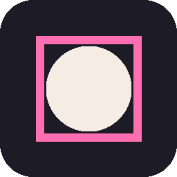
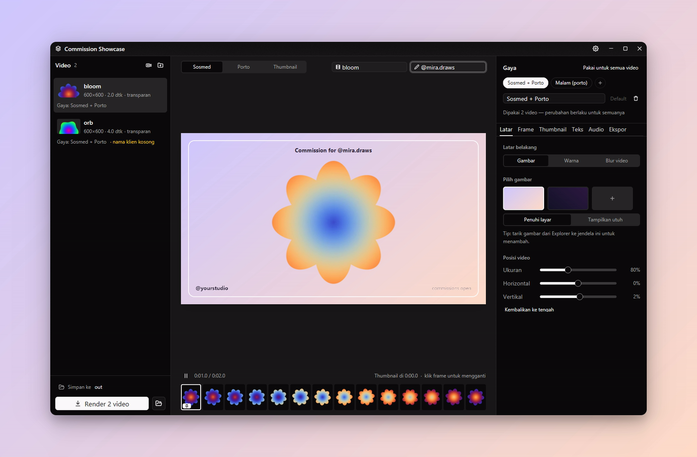
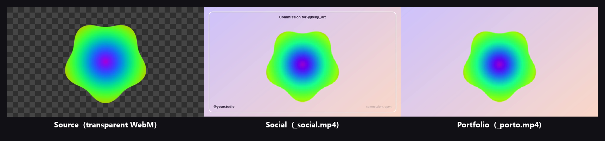
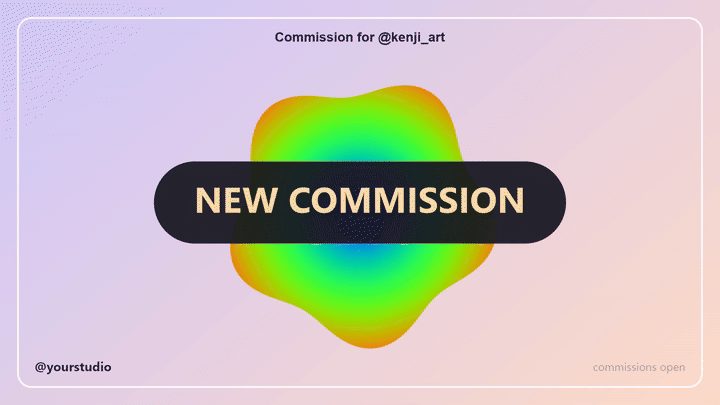
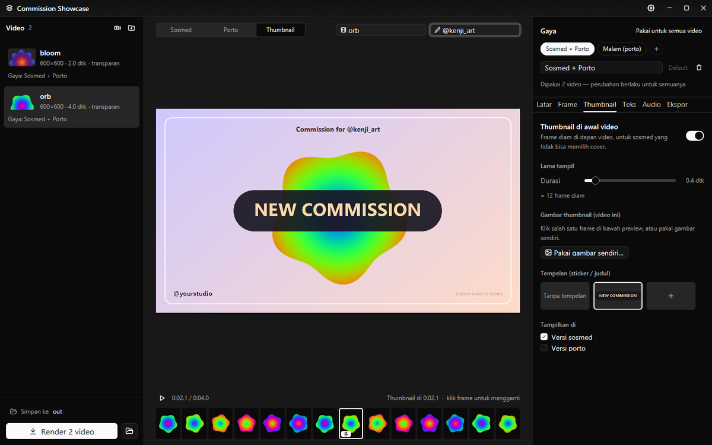
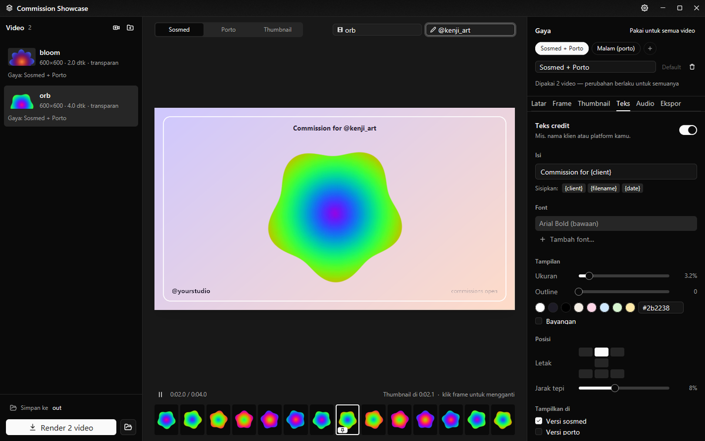
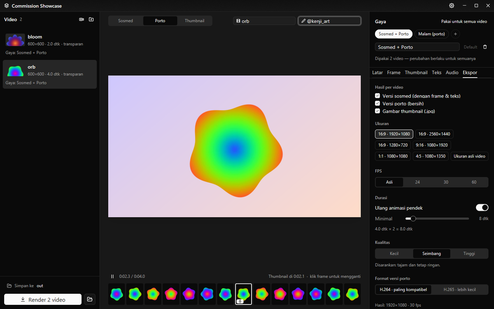
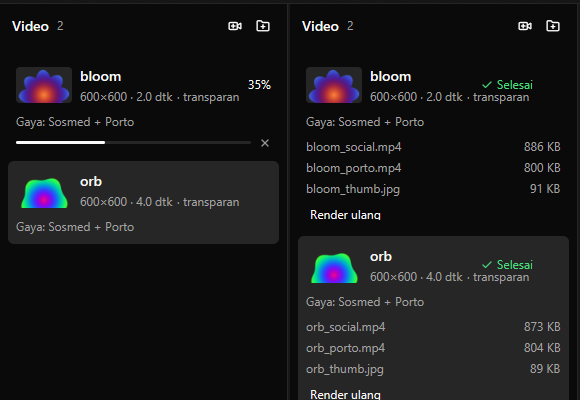
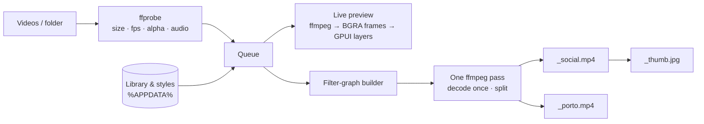

<div align="center">



# Commission Showcase

**Turn finished commissions into post-ready showcase videos in one batch.**<br/>
Background, frame & watermark, a thumbnail at the start, credit text and music, rendered as a **social** version and a clean **portfolio** version in one pass.

[](https://github.com/BillyNabil/commission-showcase/releases/latest)
&nbsp;




</div>

## Why

Artists often deliver animated commissions as **transparent WebM/MOV** files. Posting them means re-editing every time: put a background behind them, add your frame and handle, fake a cover frame for platforms that can't pick a thumbnail, render twice (one for social, one for the portfolio site), and do it file by file.

Commission Showcase does all of that from one window, for a whole folder at once.

<p align="center">
  
</p>

## What you get

<table>
<tr>
<td width="55%"></td>
<td>

From every input video:

| File | Contents |
|---|---|
| `name_social.mp4` | background · your frame/watermark · credit text · thumbnail intro · music |
| `name_porto.mp4` | background only, clean for your portfolio site |
| `name_thumb.jpg` | the cover image |

The GIF is a real `_social.mp4` from the app: the **NEW COMMISSION** cover shows for the first frames (so feeds pick it as the thumbnail), then the 4-second piece loops to 8 seconds.

</td>
</tr>
</table>

## Features

- **Transparent sources just work.** WebM VP8/VP9 alpha, ProRes 4444 MOV, MP4, MKV and GIF. The live preview decodes them directly, with no proxy files.
- **Saved library.** Add backgrounds, frames, cover stickers, music and fonts once and pick them with a click, or drag files onto the window.
- **Styles.** A style is a saved look (background, frame, cover, text, audio, export settings). Many videos can share one style; change it once and every video using it updates.
- **Thumbnail at the start.** Click any frame in the filmstrip (or use your own image), optionally add a sticker. It's held for a few static frames and also exported as a `.jpg`.
- **Credit text** with `{client}`, `{filename}` and `{date}` placeholders, a custom font, outline and shadow. The queue warns you when a video still has no client name.
- **Batch rendering.** Drop a whole folder; one ffmpeg pass per video produces both versions. Progress and file sizes show per video, renders can be cancelled, and the encoder runs at low priority so your PC stays usable.
- **Small files that stay sharp.** H.264 tuned for animation with three quality presets, plus optional H.265 for the portfolio version (usually noticeably smaller).
- **Loops short animations** (whole plays, never cut mid-loop) up to a minimum length, and mixes or replaces audio with automatic fades.
- **Follows your Windows light/dark theme.** Motion is subtle, driven by springs from [gpui-motion](https://github.com/1bye/gpui-motion).

<table>
<tr>
<td><p align="center"><sub>Pick the cover from the filmstrip, add a sticker</sub></p></td>
<td><p align="center"><sub>Credit text with placeholders</sub></p></td>
</tr>
<tr>
<td><p align="center"><sub>Portfolio preview &amp; export settings</sub></p></td>
<td align="center"><p align="center"><sub>Batch progress and results</sub></p></td>
</tr>
</table>

> The interface is in Indonesian (Bahasa Indonesia).

## Install

1. Download **`Commission-Showcase-Setup-x.y.z.exe`** from [Releases](https://github.com/BillyNabil/commission-showcase/releases/latest) and run it. It installs per user, so no admin rights are needed.
2. The app uses **ffmpeg**. If you don't have it yet:
   ```powershell
   winget install Gyan.FFmpeg
   ```
   If ffmpeg isn't on your `PATH`, set its location in the app via ⚙ (Pengaturan).

## Quick start

1. **Drop videos** (or a folder) onto the window.
2. **Pick or create a style** in the top right. Use the tabs *Latar* (background), *Frame*, *Thumbnail*, *Teks* (text), *Audio* and *Ekspor* (export).
3. For each video, fill in the **file name** and **client name** above the preview, and **click a filmstrip frame** to choose the cover.
4. Press **Render**. Results go to `Videos\Commission Showcase` by default; click the path in the bottom-left to change it.

## Performance

Measured on the same PC as the earlier Electron build of this app:

| | Electron build | This build |
|---|---|---|
| Installer | 122 MB | **7.7 MB** |
| Installed app | 110 MB+ | **31 MB** (one `.exe`) |

The new build opens its window in **0.7 s**, and memory stays flat at **~185 MB** while the preview plays.

Encoding speed is the same in both builds, since both use ffmpeg.

## How it works



- **`core/`** (`showcase-core`) has no GUI dependencies: the data model, layout math, the ffmpeg filter-graph builder, probing, rendering with progress and cancel, and JSON storage. Covered by unit tests and an end-to-end render example.
- **`src/`** is the GPUI app: queue, stage and inspector panels. The preview uses the **same layout math** as the renderer, so what you see is where things land.
- The preview has ffmpeg decode frames straight to straight-alpha BGRA, which GPUI draws as images. That's why ProRes and WebM alpha play without conversion.
- Compositing happens in RGB (`gbrp`) with a single BT.709 conversion at the end, and alpha WebM is decoded with `libvpx` so transparency survives.

## Build from source

Requirements: Windows 10/11, Rust **1.95+** (MSVC toolchain + Visual Studio Build Tools), and ffmpeg on `PATH`.

```powershell
cargo build --release
# -> target\release\commission-showcase.exe
```

> If your checkout path is long, the MSVC linker can hit the 260-character limit. Point the build somewhere short:
> `$env:CARGO_TARGET_DIR = "C:\cst"`

Tests and an end-to-end render with synthetic media:

```bash
cd core && cargo test                 # filter-graph, layout, storage tests
bash scripts/make-test-assets.sh      # creates ./test-assets (needs ffmpeg)
cd core && cargo run --example e2e    # renders 3 cases, prints sizes & progress
```

Installer ([NSIS](https://nsis.sourceforge.io/)):

```powershell
makensis -DEXE=C:\cst\release\commission-showcase.exe -DICON=assets\app\icon.ico `
         -DOUT=dist\Commission-Showcase-Setup-2.0.0.exe installer\installer.nsi
```

## Data & portable mode

The library, styles and settings live in `%APPDATA%\CommissionShowcase`. Set **`CS_DATA_DIR`** to keep them somewhere else, for example on a USB drive or in a separate demo profile:

```powershell
$env:CS_DATA_DIR = "D:\Showcase\data"; .\commission-showcase.exe
```

You can also pass video files or folders as arguments, or drop them onto the `.exe`, to queue them on launch.

## Known limitations

- Windows only for now. GPUI supports macOS and Linux, but this app hasn't been tested there.
- In the preview, the *Blur video* background is a still blurred frame and text outline is approximated. The rendered file is exact.

## Built with

[GPUI CE](https://github.com/gpui-ce/gpui-ce) · [gpui-component](https://github.com/gpui-ce/gpui-component) · [gpui-motion](https://github.com/1bye/gpui-motion) · [FFmpeg](https://ffmpeg.org/)
